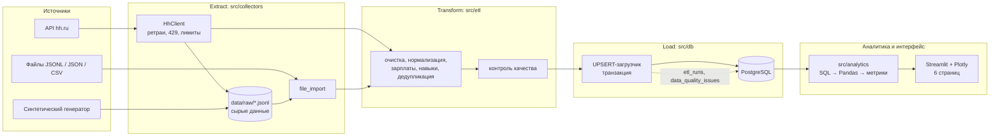
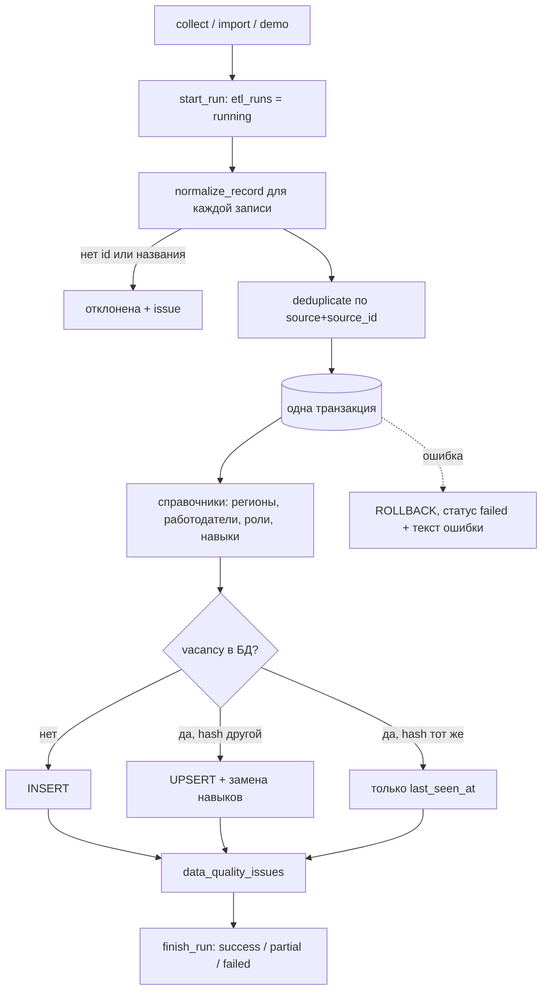
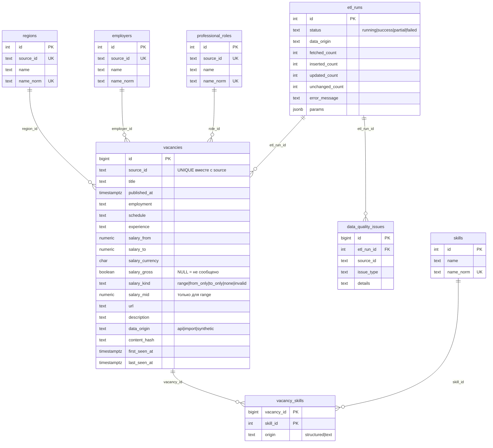

# Архитектура Big Data

> **Честная оценка масштаба.** Это учебный прототип. Он реализует *принципы* обработки больших данных
> (конвейер ETL, хранение сырых и обработанных данных, инкрементальная идемпотентная загрузка, качество,
> мониторинг, масштабируемая схема и индексы), но не является промышленной Big Data-системой: данные
> помещаются в память одной машины, а PostgreSQL и Pandas справляются с ними без распределённых вычислений.
> Граница «большие данные» определяется не названием технологии, а тем, что данные уже не обрабатываются
> на одном узле за приемлемое время/память (см. раздел 12).

## 1. Источники и поступление данных

| Тип данных (`data_origin`) | Откуда | Как попадает в систему |
|---|---|---|
| `api` | Официальный API hh.ru (`GET /vacancies`, `GET /vacancies/{id}`) | `python -m src.pipeline collect`; нужен токен приложения, если метод его требует |
| `import` | Внешний датасет / ваша выгрузка JSONL, JSON, CSV | `python -m src.pipeline import --file … --origin import` |
| `api` (повторная обработка) | Сохранённый сырой JSONL из `data/raw/` | `import --file data/raw/hh_….jsonl --origin api` — без нового обращения к hh.ru |
| `synthetic` | Генератор `src/collectors/demo_data.py` | `python -m src.pipeline demo`; помечается везде, в дашборде — предупреждение |

Для каждой записи в БД хранится `data_origin`, дата первого получения (`first_seen_at`) и последнего
наблюдения (`last_seen_at`); каждый запуск описан в `etl_runs` (источник, параметры, счётчики, статус).

**Ограничения API (проверялись по документации github.com/hhru/api; из среды разработки `api.hh.ru` был
недоступен, поэтому реальный сбор здесь не запускался):** глубина поиска — 2000 результатов на запрос
(учитывается: `page × per_page ≤ 2000`); обязателен заголовок `User-Agent` (отправляется также `HH-User-Agent`);
для части методов нужна авторизация токеном приложения (регистрация на dev.hh.ru) — токен берётся только из
`HH_API_TOKEN`. Ответы 401/403 (в т.ч. CAPTCHA) **не обходятся**: сбор останавливается, запуск получает
статус `failed`/`partial`, а пользователю предлагается импорт файла. Условия использования и хранения данных
hh.ru нужно проверить самостоятельно: полный текст описаний в CSV-выгрузку дашборда не включается.

## 2. Архитектура системы

## 3. Конвейер ETL

| Преобразование | Назначение | Правило |
|---|---|---|
| Проверка идентификатора и названия | вакансию нельзя однозначно хранить без id | отклоняется, фиксируется `missing_id` / `missing_title` |
| `clean_text`, `html_to_text` | единый формат строк, описание → текст | HTML-теги удаляются, пробелы сжимаются, описание обрезается до 8000 символов |
| `norm_key` | сопоставление работодателей/регионов | регистр, кавычки, «ё», правовая форма (ООО, АО…) |
| Даты | единая шкала | всё в UTC; смещение вида `+0300` разбирается; нераспознанное → NULL + `bad_date` |
| Зарплата | сопоставимость | см. `docs/METRICS.md`; валюты не конвертируются |
| Навыки | основа аналитики навыков | `key_skills` (origin `structured`) + словарный поиск в описании (origin `text`, осторожный, с границами слов) |
| Пропуски | не терять данные | остаются `NULL`, ничего не «додумывается»; факт фиксируется в `data_quality_issues` |
| Дедупликация | точные и конфликтующие повторы | см. раздел 7 |
| `content_hash` | определение изменений | SHA-256 от значимых полей записи |

## 4. Хранение исходных и обработанных данных

* **Сырой слой** — `data/raw/*.jsonl`: ответы источника без изменений (список + детали), одна вакансия в строке,
  атомарная запись (временный файл → переименование). Позволяет повторить ETL без обращения к источнику.
* **Обработанный слой** — PostgreSQL, нормализованная схема (ниже). Миграции — `migrations/*.sql`, раннер
  `src/db/migrate.py` (таблица `schema_migrations`, каждая миграция в транзакции).
* **Представления** — `v_vacancy_flat` (плоская витрина для аналитики), `v_skill_demand`, `v_last_etl_run`.

Зачем такие таблицы: справочники (`regions`, `employers`, `professional_roles`, `skills`) убирают повторение строк
и дают единое написание; `vacancy_skills` — связь «многие ко многим»; `etl_runs` и `data_quality_issues` нужны для
мониторинга и воспроизводимости. Лишних таблиц нет. Ограничения БД (`CHECK` на границы зарплаты и `salary_mid`,
уникальность `(source, source_id)`, внешние ключи, `ON DELETE CASCADE` для связей навыков) проверены тестами.

## 5. Структурированные данные и тексты

Структурированные поля (даты, регион, зарплата, опыт) идут в типизированные столбцы. Текст описания хранится
как очищенный текст (до 8000 символов) и используется для поиска в каталоге (`ILIKE`, спецсимволы экранируются) и
для словарного извлечения навыков. Это **не** NLP-модель: находятся только явные упоминания технологий из
справочника `src/etl/skills.py`; неоднозначные слова (Go, Rust, REST, ML, JS…) в свободном тексте не ищутся.
Происхождение навыка (`structured`/`text`) сохраняется, чтобы аналитику можно было ограничить надёжным полем.
Для промышленного объёма текстов логично перейти на полнотекстовый индекс (`tsvector`/GIN) или поисковый движок.

## 6. Качество данных

Контроль до и после обработки: `quality_summary` (доли пропусков), таблица `data_quality_issues`
(типы: `missing_id`, `missing_title`, `missing_region`, `missing_employer`, `missing_role`, `bad_date`,
`invalid_salary`, `conflicting_duplicate`, `possible_duplicate`), страница дашборда «Качество данных».

## 7. Дубли, идемпотентность и инкрементальное обновление

* **Ключ** вакансии — `(source, source_id)` с ограничением `UNIQUE` в БД.
* **Точный дубль** в пакете (тот же `content_hash`) — отбрасывается. **Конфликтующий** (тот же id, другое
  содержимое) — остаётся версия с более поздним `source_updated_at`, факт пишется в журнал качества.
  **Возможные** дубли (тот же работодатель, название, регион и дата публикации, но разные id) — только
  помечаются, не удаляются: это могут быть независимые публикации.
* **Загрузка** сравнивает `content_hash` с БД: новая запись → `INSERT`; изменившаяся → `INSERT … ON CONFLICT
  (source, source_id) DO UPDATE … WHERE content_hash IS DISTINCT FROM EXCLUDED.content_hash` и замена навыков;
  без изменений → обновляется только `last_seen_at`. Всё — в одной транзакции (при сбое откат, запуск получает
  `failed`). Повторный запуск на тех же данных даёт «новых 0, обновлено 0, без изменений N» — проверено на
  PostgreSQL 16 (см. «Что проверено» в README).
* **Инкрементальность:** сбор можно ограничить периодом (`COLLECT_PERIOD_DAYS`) и объёмом; новые вакансии
  добавляются, известные обновляются только при изменении. Закрытые вакансии из БД не удаляются — по
  `last_seen_at` можно оценить «не встречалась с даты».

## 8. Масштабирование хранения и обработки

| Узкое место | Текущее решение | Следующий шаг при росте |
|---|---|---|
| Хранение | PostgreSQL, нормализованная схема | партиционирование `vacancies` по `published_at`; архив сырых JSONL в объектное хранилище |
| Очистка | Python по записям (≈3 000 записей/с на этой машине, измерено) | векторизация в Pandas / PySpark (раздел 11) |
| Загрузка | построчный UPSERT в транзакции | пакетный `INSERT … ON CONFLICT` из `COPY` во временную таблицу |
| Аналитика | выборка в Pandas, кэш Streamlit | агрегаты в SQL / материализованные представления |
| Сбор | последовательный, с паузами | очередь задач и несколько воркеров с общим лимитом запросов |

## 9. Индексация и оптимизация запросов

Индексы (`migrations/001_init.sql`): по `published_at`, `region_id`, `role_id`, `employer_id`, `experience`;
частичный по `(salary_currency, salary_kind) WHERE salary_mid IS NOT NULL`; по `vacancy_skills(skill_id)`;
уникальные ключи справочников. Фильтры дашборда параметризованы и выполняются в БД; пагинация каталога —
`LIMIT/OFFSET` в SQL (описания в выборку для метрик не загружаются). Для полнотекстового поиска по
описаниям индекса нет (поиск `ILIKE` — линейный просмотр): это сознательное ограничение учебного объёма.

## 10. Мониторинг и журналирование

* Журнал: модуль `logging` (`src/utils/logging_setup.py`), в сообщения не попадают пароли и токены
  (логируются только факты операций; `DbSettings.safe_url` без пароля).
* Таблица `etl_runs`: статус `success | partial | failed | running`, счётчики, источник, параметры (в т.ч. доли
  пропусков и причина остановки сбора), текст ошибки. Если запуска не было, дашборд так и пишет — фиктивного
  «успешно» нет.
* Страница «Качество данных»: время и статус последнего запуска, давность данных, пропуски, история запусков.

## 11. PySpark: решение и эксперимент

**Решение:** Spark **не** включён в обязательный контур. Обоснование: тестовые наборы (десятки–сотни тысяч
строк) обрабатываются в Pandas за секунды (таблица ниже); PySpark добавил бы JVM, сложность установки и
накладные расходы запуска, не давая выигрыша на таком объёме. Spark оправдан при объёмах, не помещающихся
в память одной машины, или при необходимости параллелить очистку текстов на кластере.

**Что подготовлено:** `scripts/benchmark_spark.py` — одна и та же задача (очистка текстов, зарплата, агрегат
регион × роль с медианой, частоты навыков) на одном и том же CSV в Pandas и в PySpark, с замером времени,
размера данных, условий и проверкой совпадения результатов. Spark запускается автоматически, если установлен
`pyspark` (и Java).

**Реально полученные результаты** (`docs/benchmark_results.json`; синтетические данные; 2 ядра CPU, 8 ГБ ОЗУ;
Python 3.13.16, pandas 3.0.5; медиана из 3 запусков, включая чтение CSV):

| Строк | Размер CSV | Pandas, с | PySpark |
|---:|---:|---:|---|
| 50 000 | 11,87 МБ | 0,665 | **не запускался** (pyspark не установлен в среде) |
| 200 000 | 47,45 МБ | 2,27 | **не запускался** |

Вывод ограничен измеренным: на этих объёмах Pandas укладывается в секунды, время растёт почти линейно
(×3,4 при ×4 строках). **Сравнение со Spark и коэффициент ускорения не приводятся: они не измерялись.**
Чтобы получить их, установите `pyspark` и выполните команду из раздела «Бенчмарк» README.

## 12. Ограничения и переход к распределённой обработке

Ограничения: один узел PostgreSQL; построчная очистка в Python; Pandas требует умещения выборки в память;
словарное извлечение навыков; нет автоматического расписания запусков (запуск вручную или через cron);
нет курсов валют и пересчёта периодов оплаты.

Путь к распределённой обработке (описание, не реализовано): сырые данные в Parquet на объектном хранилище →
очистка и агрегаты в PySpark (те же правила нормализации, вынесенные в UDF/встроенные функции) →
витрины в PostgreSQL/ClickHouse → тот же дашборд. Оркестрация (Airflow) и очередь (Kafka) целесообразны при
регулярном потоковом сборе; в проект они **не добавлены**, так как для учебного объёма не нужны.
