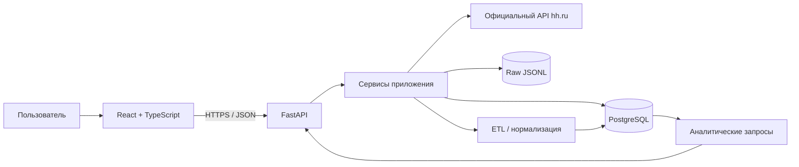

# Целевая архитектура Frontend / Backend

**Версия:** 1.0  
**Статус:** проектное решение; не отражает уже развернутую архитектуру.

## 1. Архитектурное решение

Текущая рабочая версия использует Streamlit как UI и напрямую вызывает модули аналитики и БД. Целевой вариант разделяет пользовательский интерфейс и серверную часть:

- **Frontend:** React + TypeScript. Отвечает за отображение, маршрутизацию, формы, состояние фильтров и визуализацию.
- **Backend:** Python + FastAPI. Предоставляет HTTP API, проверяет входные параметры, вызывает сервисы и формирует ответы.
- **Application services:** повторно используют существующие ETL, аналитику, коллектора и репозитории там, где это возможно.
- **Database:** PostgreSQL. Backend — единственный компонент, который напрямую обращается к БД.
- **Data source:** официальный API hh.ru и файловый импорт. Сбор запускается на серверной стороне, а не из браузера.

React и FastAPI — выбранный целевой стек для следующего этапа, а не требование к текущему Streamlit-деплою.

## 2. Контекстная схема



Браузер не получает пароль БД, токен hh.ru или прямой доступ к SQL. Все секреты и операции сбора остаются на сервере.

## 3. Предлагаемая структура каталогов

На переходном этапе сохраняем существующий пакет `src/` и добавляем независимый `frontend/`. Не переносим и не дублируем ETL до появления тестов на совместимость.

```text
hh-bigdata/
├── frontend/
│   ├── src/
│   │   ├── app/                 # роутер, layout, providers
│   │   ├── pages/               # страницы приложения
│   │   ├── components/          # общие UI-компоненты
│   │   ├── features/            # overview, salaries, skills, catalog...
│   │   ├── services/            # HTTP-клиент и API-функции
│   │   ├── hooks/               # общие React hooks
│   │   ├── types/               # типы API
│   │   └── styles/              # токены, глобальные стили
│   ├── public/
│   ├── package.json
│   └── vite.config.ts
├── backend/
│   └── app/
│       ├── main.py              # создание FastAPI-приложения
│       ├── api/v1/              # маршруты и схемы API
│       ├── core/                # настройки, ошибки, безопасность
│       ├── services/            # прикладные сценарии
│       └── dependencies.py      # зависимости FastAPI
├── src/                         # существующая бизнес-логика: ETL, DB, analytics
├── migrations/
├── tests/
└── docs/
```

### Почему не переносим всё сразу
- Существующие импорты вида `src.analytics.*` и `src.db.*` продолжают работать.
- Streamlit остаётся контрольным интерфейсом.
- Backend сначала вызывает существующие функции, а не переписывает расчёты.
- Миграция по вертикальным сценариям позволяет проверять результат на каждом шаге.

## 4. Границы ответственности

| Слой | Отвечает за | Не должен делать |
|---|---|---|
| Frontend | интерфейс, фильтры, состояние, графики, отображение ошибок | подключаться к PostgreSQL или хранить секрет hh.ru |
| API | HTTP-контракты, валидацию, коды ответа, авторизацию операций | содержать SQL и сложные формулы аналитики |
| Services | сценарии: overview, catalog, ETL, quality | зависеть от React/браузера |
| Analytics | запросы, DataFrame, расчёт метрик | знать о HTTP |
| ETL / collectors | получение, нормализацию, загрузку | знать о UI |
| DB | соединение, миграции, транзакции | возвращать внутренние исключения наружу |
| hh.ru | внешний источник | считаться гарантированно доступным |

## 5. Поток чтения аналитики

1. Пользователь меняет фильтры в браузере.
2. Frontend отправляет GET-запрос с query-параметрами.
3. FastAPI валидирует значения через Pydantic.
4. Сервис формирует существующий объект фильтров и вызывает функции слоя аналитики.
5. Слой SQL выполняет параметризованный запрос к PostgreSQL.
6. Сервис преобразует результат в DTO/схему ответа.
7. Frontend отображает KPI, график или таблицу.

## 6. Поток сбора вакансий

1. Оператор отправляет POST-запрос на запуск сбора.
2. Backend проверяет право запуска и допустимые параметры.
3. Коллектор обращается к официальному API hh.ru с серверным токеном.
4. Raw-данные сохраняются в JSONL, если включено сохранение.
5. Существующий ETL нормализует, дедуплицирует и загружает записи.
6. Backend возвращает идентификатор запуска.
7. Frontend опрашивает состояние запуска через GET.
8. Итоговые счётчики и ошибки отображаются на странице качества.

Для длительного сбора в будущем использовать фоновую очередь задач. На первом этапе допустим синхронный вызов только для небольших лимитов и тестовой среды; HTTP-запрос не должен блокировать пользовательский интерфейс на длительное время.

## 7. Конфигурация и окружения

- Frontend получает только публичный URL API.
- Backend получает DB_*, HH_API_TOKEN, HH_USER_AGENT и настройки логирования из окружения/секретов.
- Секреты не передаются в ответы API и не включаются в логи.
- Локальная разработка использует отдельные файлы окружения, исключённые из Git.
- Production использует Secrets провайдера.

## 8. CORS и безопасность

- Разрешать только явно заданные origins frontend.
- Не использовать `allow_origins=["*"]` вместе с credentials.
- Проверять входные параметры и ограничивать page_size.
- Операции запуска ETL должны быть защищены. До появления полноценной авторизации включать их только в доверенном deployment или закрывать отдельным секретом оператора.
- Не выдавать stack trace и SQL-ошибки клиенту.
- Ограничивать частоту и объём тяжёлых запросов.

## 9. Наблюдаемость

Каждый запрос получает correlation/request ID. Логируются маршрут, длительность, код ответа и безопасные технические сведения. Для ETL используются уже существующие `etl_runs` и `data_quality_issues`. Секреты и полные тексты вакансий не должны попадать в логи.

## 10. Этапы миграции

1. Зафиксировать API-контракты и схемы ошибок.
2. Добавить минимальный FastAPI backend с health-check.
3. Подключить существующую конфигурацию и DB session.
4. Реализовать read-only overview endpoint и проверить совпадение с Streamlit.
5. Реализовать каталог, зарплаты, навыки и географию.
6. Добавить ETL history и безопасный запуск сбора.
7. Создать React-приложение и подключить read-only endpoints.
8. Перенести страницы по одной, сравнивая результаты.
9. Провести интеграционные тесты и только после этого решать вопрос о замене Streamlit.

## 11. Критерии готовности архитектурного перехода

- Frontend не имеет DB credentials и HH_API_TOKEN.
- Backend запускается независимо от Streamlit.
- API имеет документированные схемы запросов и ответов.
- Метрики совпадают с текущим Streamlit для одной и той же выборки.
- Ошибки и пустые состояния отображаются понятно.
- ETL запускается только с серверной стороны.
- Streamlit продолжает работать до подтверждения функционального паритета.
